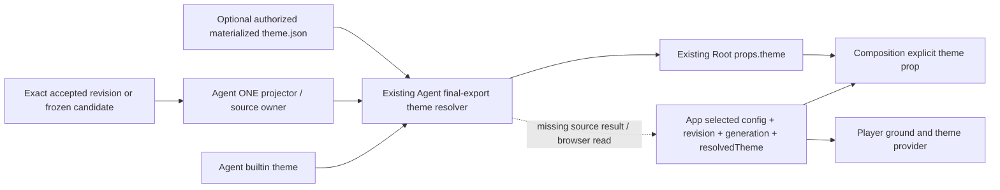

# FINAL06:07 — common resolved theme, UNAPPLIED design

**Authority found; complete delivery seam missing.** Preserve Agent final export. Use its existing `_resolved_theme_for_render`, with no second resolver/default object. The smallest existing browser-readable source for the **implicit default only** is App's `@astrid` build-source read. There is no current returned host-props/document/artifact read that carries a per-config Agent-resolved theme into ordinary preview. The App worker's optional local prop is necessary consumer preparation, not a complete integration. This is a source-backed owner handoff, not an M3/parity claim.

Read PLAN and Viewing INBOX through FINAL06:07. The earlier public-default Agent-core patch and navy-copy App adapter are rejected; neither is included. Prior research directory `scratchpad/luna/reports/` is absent here. Instead read the available flat default-theme-owner-proposal, agent-public-default-theme and app-resolved-theme-ground reports, current public scene transport proposal/review/OWNER-NEEDS, and Agent source/capture implementation. Their superseded policy prose does not override PLAN.

## Exact reviewed source

- Agent assigned worktree and integration: `384918908aa8c75229c2b6ccdd8fda03b7ce24a1`.
- App integration: `b8064ecf16c97a579d0bf945cef5df15a2085185`.
- Runtime integration: `e8a24e301c2d5fed7ac5a9d10c7ec226e11199d8` (read only).
- Composition integration: `ff0536bb53d84db5008b859be304b932b1dd5252` (read only).
- Inactive scene transport: flat reviewed candidate `ae6c3ebc83aae785e4e4c83c9f0a153479bdb2bf` plus the reported reserved-role-key fix, **not present in assigned Agent HEAD**. Read its flat patch and review; no claim of executing that candidate.

Paths in the following table are relative to those repo roots. Source file SHA256s for the actual imported theme modules are in `handoff-vw-m3-resolved-theme-common-source-values.json`.

| Source / owner | Actual behavior | Consequence |
| --- | --- | --- |
| Agent core `astrid/core/theme/_schema.py:175,228,250` | `BUILTIN_DEFAULT_THEME`, `builtin_theme()` fresh copy, schema validation, strict absolute runtime `theme.json` load | ONE navy/Arial/cyan/full-style authority. Core read only. |
| Agent Rendering `astrid/packs/rendering/shared/rendering_backend/__init__.py:75,89` | Runtime-materialized theme wins as base; otherwise builtin. Historical slug is metadata. Authored visual children overlay the base; merge is shallow at the visual child level. Returns `{id, visual}`. | Reuse the whole returned value; never look up an App installed theme by slug and claim it is Agent resolution. |
| Agent host `astrid/core/execution/generic_host.py:6802,6826,6873` | Authorized CAS bytes are hash checked, written under attempt `managed-objects`, theme input named `theme.json` | No browser filesystem path, object digest inferred from a slug, or theme folder search. Host materialization alone does not deliver preview props. |
| Agent task `astrid/packs/rendering/actions/render/task_adapter.py:286,365` | Snapshot/registry staged in owned input lifetime; normal managed render request passes timeline identity/registry/materialization; no resolved theme output | Do not add browser backend/theme options or invoke export merely to obtain a preview theme. Generic materialization capability is not proof that ordinary App export currently carries arbitrary custom-theme pins. |
| Agent Rendering `.../renderers/remotion/run.py:1103-1113,1167,1362` | Resolves theme, builds `merged_props={timeline,assets,theme,review}`, writes private `.remotion-props.json`, deletes it in finally | Actual common **value** exists here; reusable returned preparation result / portable read does not. Do not read the deleted file later or publish attempt-local asset URLs. Alpha layer rendering intentionally replaces background with transparent at :1156; that segment-specific mutation is not the opaque preview default. |
| Agent Root `remotion/src/Root.tsx:83` | Existing props spread into `TimelineComposition`; registry selection uses `props.theme` | Existing Composition prop already sufficient; no package changes. |
| Composition `typescript/src/types.ts:105`, `TimelineComposition.tsx:328,334` | Optional `theme?: Theme`; ground and provider use explicit props theme | Pass the same full value to props.theme. Do not change package DEFAULT_THEME. All 0.0.8/9/10/11 artifacts remain immutable. |
| Agent source/capture `astrid/sdk/timeline/commit.py:396,490,515`; `astrid/sdk/authoring_render_preview.py:31,71,86` | Optional provider capture projects verified closure/candidate via ONE projector; returns config/registry/expansion, not theme. Candidate validation retains exact source/children. | No provider/core edit. Keep source authority with Agent owner; a theme output does not certify a candidate or accept edits. |
| Reviewed inactive scene `scene_answers.py::host_frames_at`, `remotion/scene-query.mjs` | Requires supplied Root props.theme and explicit basis; returns frame answer rows only | Not a source-preparation/read endpoint. Do not invent Runtime scene method or activate scene transport to acquire a theme. |
| App read `src/integrations/runtime/dataProvider.ts:1263-1320`; `lib/timeline-data.ts` | Reads immutable parent payload then returns config/registry/head; load/store projections contain authored config | No resolved Theme or theme artifact descriptor. Generic getDocument/getObject cannot discover an absent resolved theme object. |
| App `components/PreviewPanel/useVideoEditorPreviewComposition.ts:14`, `useVideoEditorPreviewSurface.tsx:40` | Resolves/chooses preview config and revision identity; working copies and accepted heads distinct | Exact selected config, not latest canonical head, must be paired with theme. |
| App `components/PreviewPanel/RemotionPreview.tsx:121,149,168,258` | Existing local delivery = config/revision/generation, debounced while paused and next-RAF while playing | Additive consumer-only `resolvedTheme?: Theme` belongs inside same delivery, including generation and metadata-only guards. App worker owns prototype. |
| App `compositions/installed-themes.ts:98`; `TimelineRenderer.tsx:1591,1727` | Local installed/default recursive resolver; canvas independently black | When a delivered Agent theme exists, use it directly and paint its bg. No second merge. Preserve existing authored/installed path while absent delivery remains explicitly unqualified. |

## Small contract: source owner to local preview owner

**Minimal additive local result, proposed rather than present:** Agent's pack-owned trusted source preparation returns the already computed `theme: Theme` next to its **same exact** prepared config. If it returns complete Root props, reuse `props.theme` rather than introduce another member. Current render preparation is inline, not a returned `PreparedSource` API. Factoring/retaining it is work for Agent source/materialization owner, not a new Runtime provider/API. This report deliberately does not name an invented getter or endpoint.

**Consumer type:** optional `resolvedTheme?: Theme` on RemotionPreview/TimelineRenderer; `Theme` is the existing `@banodoco/timeline-composition/theme-api` structural type. In `PreviewDelivery` include the value with `config`, `revision`, `generation`. App's current root adapter has no external theme input, so the App prototype adds a local prop. When present, it is a final resolved value, never an override or an installed-theme selector. Composition gets `theme={resolvedTheme}`; Player canvas gets `resolvedTheme.visual.color.bg`. Do not deep-merge it again.

**Pairing:** source owner must associate the result with existing accepted project/timeline/revision+content digest and exact selected dependency closure, or the exact frozen candidate digest/base for a working copy. Runtime theme input, if any, belongs to the same authorized source selection and digest. The local App binds that source result to the selected config object and mailbox generation. A base revision alone cannot identify two drafts. Theme-only changes must advance generation too; metadata-only recovery may only update a delivery with matching config AND theme. A stale callback cannot attach an old theme to a newer config. Preserve the last complete delivered pair on failed reads, using the existing unavailable-target display; never silently call a new theme fallback “the requested revision”.

**Owner/lifetime:** Agent source/capture owner owns exact accepted/candidate inputs; Viewing Rendering owns materialization + resolution; App preview owns atomic mailbox delivery. Copy the JSON-safe theme value before closing source/materialization lifetime; retain it only with its paired delivery. Never retain asset-server paths/URLs or rerun render to read a theme. No theme data goes into authored film/revision payload, save command, commit receipt or source certification result. Current source owner must supply the missing result/read connection; optional local props alone do not complete this contract. No transport implementation is claimed or proposed as a new wire DTO/endpoint here.

## Existing-read option for implicit default only

For prompt implementation without a new runtime read, the existing App build-source seam can carry a **generated default resource**. This is narrower than the complete per-source contract above and needs owner review:

1. Generate `astrid/packs/rendering/ui/resolved-default-theme.json` by calling the existing resolver on a minimal no-theme/no-override config with no runtime pin. Do not transcribe the Python constant into TS or JSON by hand. The prototype's `--default-only` does this today, outside product code. The JSON contains the full `{id,visual}` returned by Agent, not color alone.
2. Put that generated path in the existing App `config/astrid-vendor-files.json` declared-files set. `scripts/astrid-landing/refresh-vendor.mjs:39-65,124` already copies declared JSON directly from a pinned Agent commit, records commit/tree and every file SHA256. `scripts/build/verify-astrid-vendor-sources.mjs:49-72` already rejects changed/missing/extra files. App `config/vite/astridSource.ts:132` / `vite.config.ts:158` already read the selected `@astrid` source. A tool-bound resource is another existing carrier, but current video-editor tool resources are empty; don't claim automatic inclusion of a new rendering resource.
3. Add a generator `--check` in Agent release/check and App source-build preparation against the **selected native Agent release**, before bundling. This invocation does not exist today. A source content change without regeneration must fail, as the prototype stale-file probe does. Production App imports the resource from `@astrid`; it must not maintain a second App-local default JSON. No changes to Composition tgz/lock/version.
4. Ship App browser resource and native Agent from the same existing pinned source release. A startup-selected native host changing independently invalidates this assumption. Current App read does not expose the native host's theme-source binding, so do not claim this design detects independent deployed-host drift. Deployment owner must pair the releases or keep this option unqualified. Build hashes alone prove content integrity, not equality to an independently updated running host.
5. Scope claims to missing/default implicit base. Preserve authored leaves and installed explicit theme choices on their existing path. Any local merge after importing the base is **not** proof of exact Agent per-config resolution. Runtime custom pin transport, slug-only installed themes vs Agent slug metadata, partial nested type/family/size merges, font availability, and historical/working-copy runtime theme selection remain unqualified. A complete explicit visual override can be tested positively, but does not qualify arbitrary partial merges or pins.

This design is a generated projection of ONE authority, not another editable policy. No generated product resource, manifest entry, pin, build invocation or App import was applied here. The generated flat JSON is only a reproducible prototype and MUST NOT be adopted as a hidden fixture/default override. If complete arbitrary per-source resolution is required now, use the missing local result contract; this default-only path cannot substitute for it.

## Prototype / evidence

All artifacts are flat under this report's absolute directory. `handoff-vw-m3-resolved-theme-common-source-prototype.py` directly imports the actual final resolver and emits config+theme cases with source identity; `--default-only --check` demonstrates generated-resource freshness without rendering. `values.json` contains actual implicit, explicit default, color override and complete authored visual outputs. The App worker received the exact path/type through `...-to-app.md`; its independent local mailbox prototype is reported separately.

`UNAPPLIED-tests.patch` proposes five ordinary tests at `tests/packs/rendering/test_resolved_preview_theme.py`. They compare whole actual Agent values against builtin plus authored inputs, require fresh defaults/no file mutation, and retain full-style remainder. Executed outside the repo with the same imports; no main-suite registration is claimed until applied. Existing selected main-suite tests ran too: 17 pass total (5 proposal + 12 existing). Runtime custom pin and nested App delivery positives are not supplied, so those remain unqualified. No new xfail/skip/it.fails, behavior rewrites, browser/render/socket/full/install/network or central test request.

Owner-film note: document App's approved implicit preview change to Agent final-export full style (ground, foreground, typography, accent, sizes, weights, line height, motion). Export remains unchanged. This note is supplied for the owner list; this worker does not edit that shared ledger or rewrite films.
